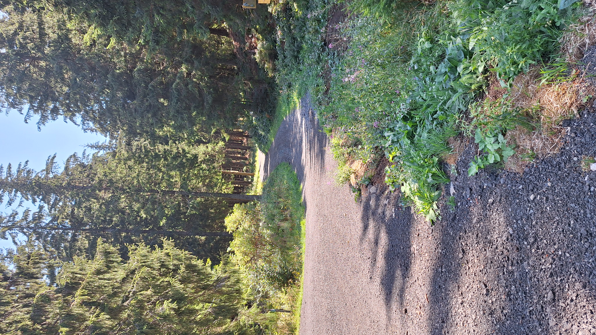
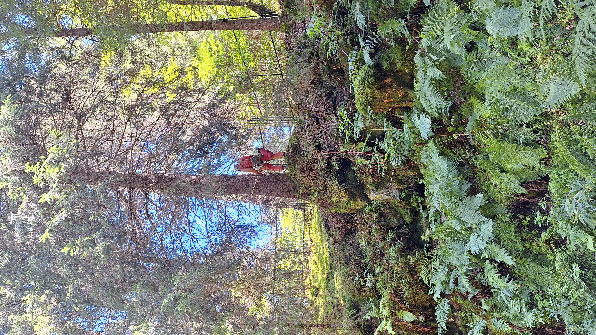
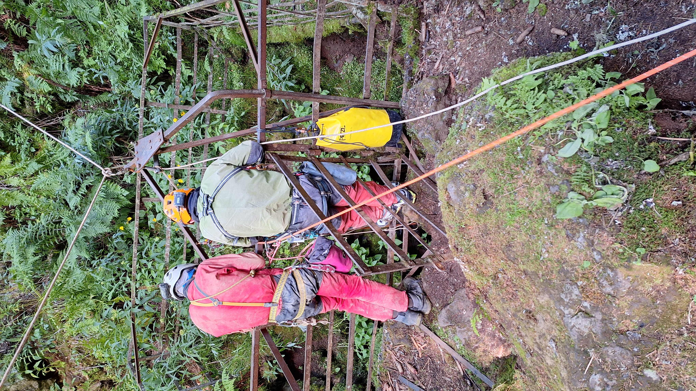
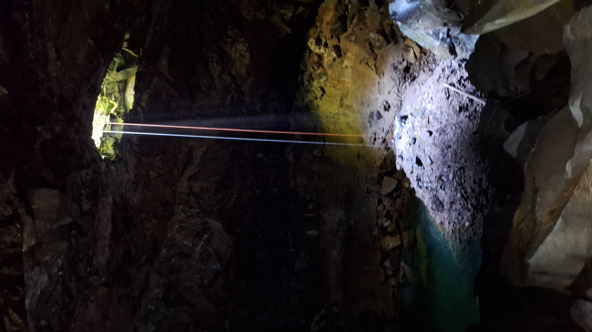
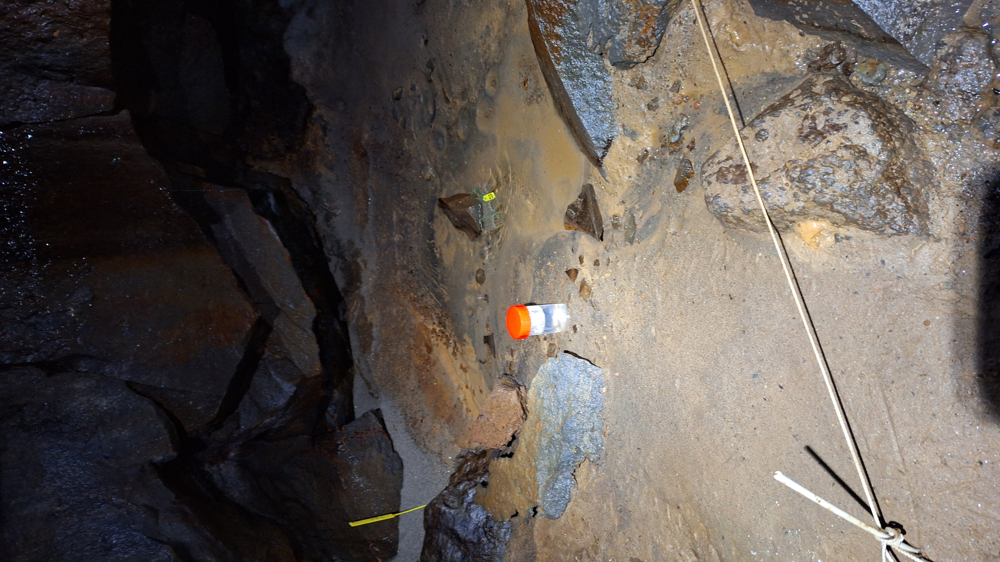
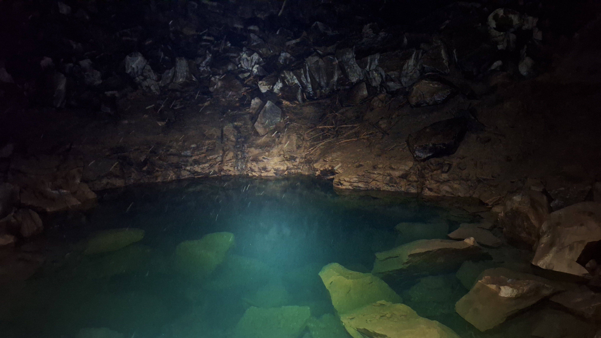
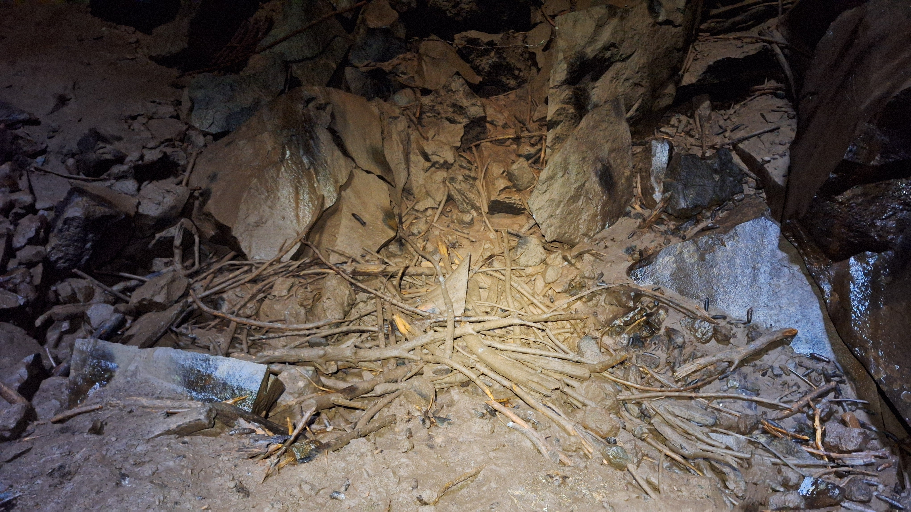
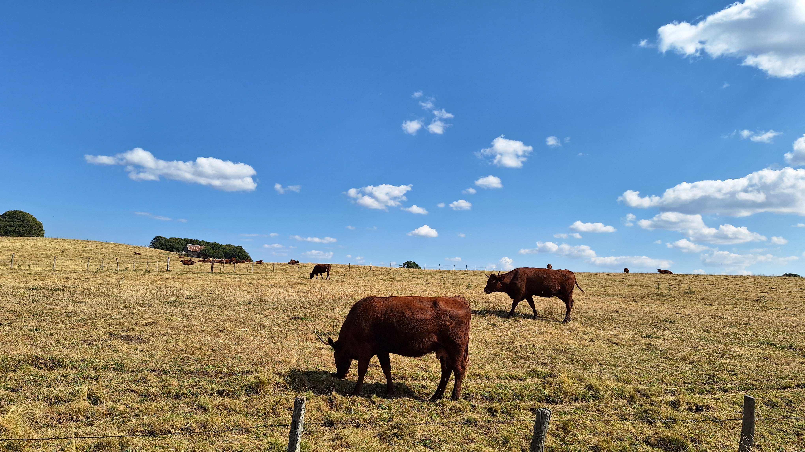

Sortie decouverte pour montrer a des speleos savoyards la seule cavite naturelle auvergnate : Le creux de soucy.
Grande salle basaltique habritant un lac, il acceuille une petite vingtaines de sources dont l'ecoulement est regulierement mesure par les scientifiques.

## Approche

En ete, nous ne pouvons pas nous garer pres du creux, il faut donc faire une petite marche d'approche de 10 minutes dans la foret, ce qui n'est pas facile sous 40 degres. 

## Equipement

Le trou est equipe d'une structure metallique permettant d'installer un pendule sans frottement, cependant, la robustesse de cette structure semble discutable. C'est pour cela que nous mettons toujours en place un hauban permettant de rigidifier la structure et de se proteger dans le cas ou elle viendrait a faillir.

## Descente

Nous etions quatres et deux lignes ont ete mises en place. C'etait ma premiere sortie, les cadres ont decide de m'assurer en boucle, le puit ne faisant que 23 metres, la corde pouvait etre doublee. Il faisait extremement froid dans le puit, nous n'avions pas de thermometre mais il fait en general autour de 5 degres, contre les 40 de l'exterieur, j'ai rarement eu aussi froid.

## Progression

La salle n'est pas tres grande elle fait [61x47x23](https://france3-regions.franceinfo.fr/auvergne-rhone-alpes/puy-de-dome/clermont-ferrand/le-creux-de-soucy-le-plus-mysterieux-des-lacs-d-auvergne-3254959.html) metres.

Le parcours consiste a se detacher sur le monticule a l'aplond de l'entree et de passer sur le bord. On peut en faire le tours en longeant le bord des parois via une marche en alternant des blocs et de l'argile. 

Nous pouvons en general mesurer l'ecoulement des sources emergeants dans le creux, mais lors de notre passage, tout etait a sec.

De plus, j'avais la sensation de sentir du gaz, il pourrait venir des arbres en decomposition qui sont tombes dans le creux au cours de centaines d'annees mais ne sont emergees que depuis cet ete.

## Remontee

Rien ne pose de probleme ici, on remonte en pedale simple en poussant tres fort et en attendant que ca passe. Ne pas hesiter a enlever une couche.

On rentre sous le regard paisible des salers.
