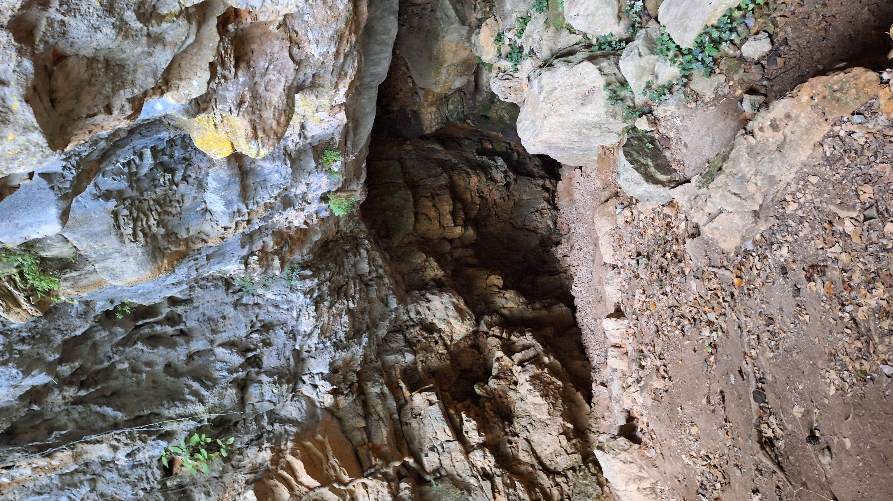
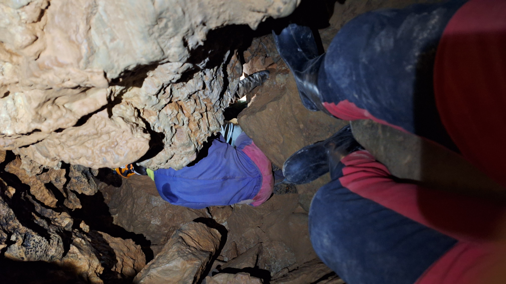
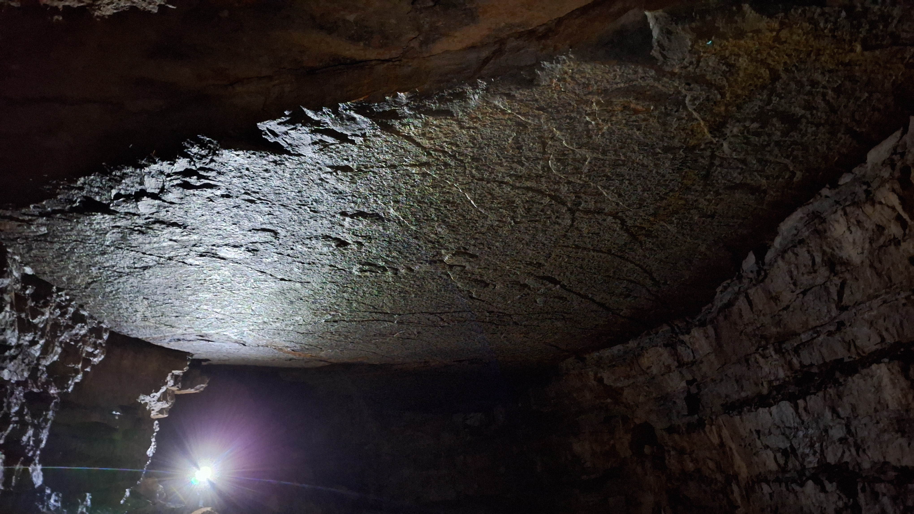
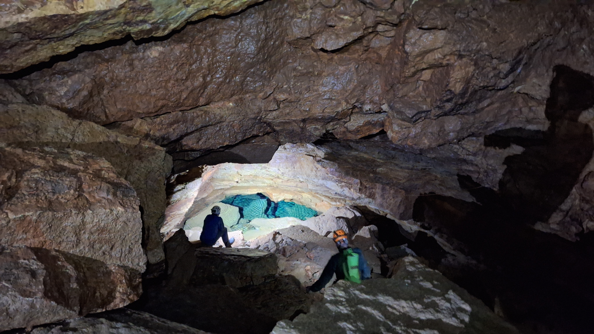
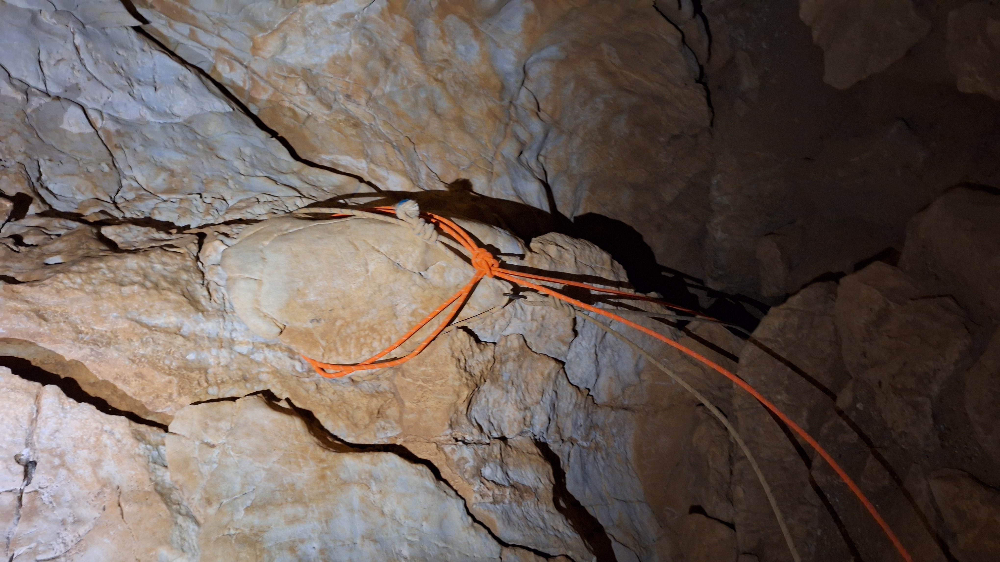
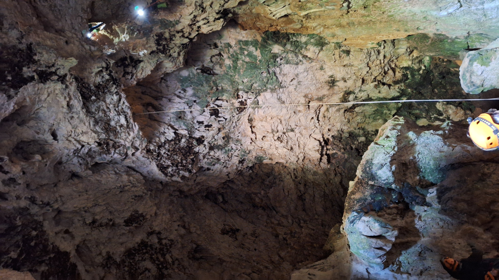
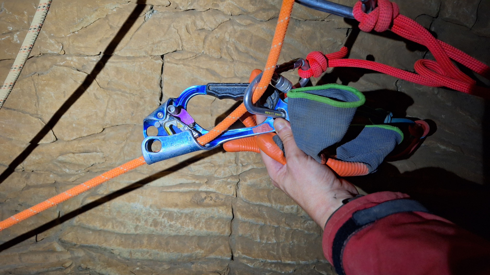
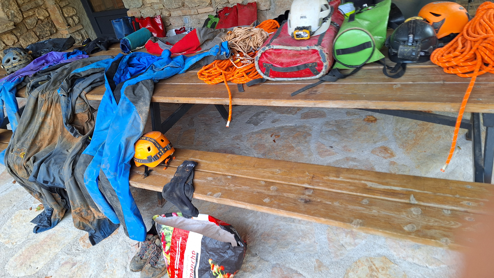

JNSC : Journees nationales de la speleologie et du canyonnisme.

A cette ocasion, le GSA a organise un week-end pour faire decouvrir la speleo aux curieux (moi inclus !).
Le week-end a permis la decouverte de deux cavites sur la comune de Castelbouc dans les gorges du tarn (entre Ispagnac et Saint-Enemie).

## Premier jour

Trajet depuis Clermont-Ferrand et grotte horizontale Castelbouc 4. Pas besoin de materiel a part son casque et sa lampe, mais un bon sens de l'orientation est primordial. On se perd dans des grandes salles remplis de gros blocs, et les boyaux laissent voir tout un tas de trou dans lesquels il ne faut pas aller au risque de perdre le groupe !

### Progression

Pour progresser dans cette cavite, beaucoup de passage a ramper, les genouilleres sont appreciables.

::: {layout-ncol="2"}

 

:::

### Aspects remarquables

::: {layout-ncol="2"}

:::

La couleur de l'eau est toujours magnifique, la secheresse rend le siphon minuscule, il est cense etre plus etendu.

## Deuxieme jour

::: {layout-ncol="2"}

Cette cavite etant plus verticale, il a fallut dans un premier temps equiper la cavite pour nous permettre de descendre le puits en 2 temps.
Etant un grand nombre de participant, la queue en tete de puits nous a laisse le temps de faire  un cours sur les noeuds :

:::

Nous avons pu descendre un beau puit qui arrive dans la resurgence a ciel ouvert sur le tarn (croyez moi je n'ai pas de photo donnant sur l'exterieur....)

Pour le desequipement nous avons pu profiter d'une belle vire ascendante qui nous a permis de chausser le bloqueur de point : 

Technique qui permet de s'aider de la corde dans les passage en montee ou les prises de mains et de pieds se font rares.

On peut maintenant sortir et laver les affaires en prenant le temps de reflechir a tous les noeuds que nous avons appris.

